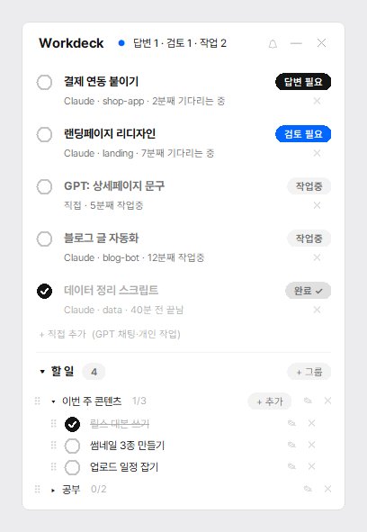
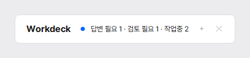

# Workdeck

**Claude Code · Codex 작업 상태를 화면에 띄워주는 Windows 플로팅 창**

Claude Code랑 Codex한테 일을 시켜놓고 기다리다가, 딴짓하느라 다 끝난 걸 한참 뒤에 확인해본 적 있으시죠?
저는 홈페이지 작업, 영상 편집, 앱 개발을 AI 여러 개한테 동시에 맡기다 보니 집중력이 너무 흩어지더라고요.
그래서 만들었어요. **Claude Code와 Codex가 지금 일하는 중인지, 내가 확인할 차례인지**를 화면 구석에 계속 띄워두는 작은 창이에요.

| 자동으로 잡혀요 | 자동으로 안 잡혀요 (직접 추가로 올려두기) |
|---|---|
| **Claude Code** (Claude 데스크톱 앱의 Code 탭, 터미널) | claude.ai 웹, Claude 앱의 일반 채팅 |
| **Codex** (Codex 앱, Codex CLI) | ChatGPT 일반 채팅 |

<p align="center">
  
</p>

평소엔 한 줄로 접어서 화면 아래에 두면 돼요. 확인할 게 생기면 파란 점이 켜지고 "띵" 소리가 나요. 소리 종류와 크기는 ⚙ 설정에서 바꾸거나 끌 수 있어요.

<p align="center">
  
</p>

## 왕초보 설치법 (3분)

컴퓨터 잘 몰라도 괜찮아요. 이 세 가지만 하면 돼요.

1. **[여기를 눌러 ZIP 받기](https://github.com/nyangbuilder-lab/workdeck/releases/latest/download/Workdeck.zip)** → 받은 파일을 우클릭 → **압축 풀기**
2. 압축 푼 폴더에서 **`install.bat`** 더블클릭
   - 파란 "Windows의 PC 보호" 창이 뜨면 **추가 정보 → 실행** 을 눌러주세요.
   - Python이 없으면 알아서 같이 설치해요. 확인 창이 뜨면 **[예]** 만 눌러주세요.
3. "설치 완료"가 뜨면 끝이에요. Workdeck 창이 바로 떠요.

그다음 Claude Code 대화창을 새로 열고 아무 메시지나 보내보세요. 목록에 바로 나타나요.

> 공식 배포처는 이 저장소 하나예요. 다른 곳에서 받은 파일은 쓰지 마세요.

## 이런 걸 해줘요

- **Claude Code 대화 상태를 자동으로 보여줘요.** 메시지를 보내면 `작업중`, 권한 승인이나 질문을 기다리면 `답변 필요`, 답변이 끝나면 `검토 필요`로 바뀌어요.
- **Codex(Codex 앱·Codex CLI) 작업도 같이 보여줘요.** 설정은 아무것도 안 건드리고, Codex가 남기는 작업 기록만 읽어요.
- **다 본 건 `완료`로 표시해요.** 상태 알약이나 왼쪽 동그라미를 누르면 `완료 ✓`로 바뀌고 맨 아래로 내려가요. 그 대화에 새 일을 시키면 완료는 자동으로 풀려요.
- **GPT 일반 채팅처럼 자동으로 안 잡히는 일은 직접 추가**할 수 있어요. 알약을 누를 때마다 작업중 → 검토 필요 → 완료로 바뀌어요.
- **할 일 체크리스트**도 같이 있어요. 그룹별로 접고 펴고, ✎로 고치고, ✕로 지우고, ⠿를 잡고 끌어서 순서를 바꿀 수 있어요.
- **창은 하나만, 작업표시줄에 아이콘으로** 떠요. 화면 아래쪽에 두면 펼칠 때 위로 자라고, 접으면 다시 내려가요.
- **다크모드**도 있어요. ⚙ 설정에서 바꿀 수 있어요.
- 할 일이 많아져도 창은 화면 안에서 멈추고, 할 일 부분은 **마우스 휠로 스크롤**돼요.

## 필요한 것

- Windows 10 / 11
- Python 3.12 이상. 없으면 `install.bat` 이 윈도우 기본 설치 도구(winget)로 Python 3.13을 같이 설치해요.
  자동 설치가 안 되는 PC라면 [python.org](https://www.python.org/downloads/)에서 직접 설치하고, 설치 첫 화면에서 **"Add python.exe to PATH"** 를 꼭 체크해 주세요.
- Claude Code (데스크톱 앱의 Code 탭이나 터미널) 그리고/또는 Codex

추가로 설치할 라이브러리는 없어요. 파이썬에 기본으로 들어 있는 것만 써요.

## 설치 자세히

작업표시줄에 두고 싶으면 바탕화면의 **Workdeck** 아이콘을 우클릭 → **작업 표시줄에 고정**을 눌러주세요.
이미 열려 있던 Claude Code 대화는 상태가 안 잡혀요. 새로 연 대화부터 잡히니까 대화창을 한 번 새로 열어주세요.

설치하면 이렇게 바뀌어요. 숨기는 것 없이 전부 적어둘게요.

| 무엇을 | 어디에 |
|---|---|
| 프로그램 복사본 | `%USERPROFILE%\.claude\hooks\workdeck.py`, `workdeck.ico` |
| Claude Code 훅 7개 등록 | `%USERPROFILE%\.claude\settings.json` (바꾸기 전에 `settings.json.bak-workdeck-날짜` 로 백업) |
| 바로가기 | 바탕화면, 시작 메뉴, 시작프로그램(컴퓨터 켜면 자동 실행) |
| 상태·할 일 저장 | `%USERPROFILE%\.claude\session-status\` |

컴퓨터 켤 때 자동으로 뜨는 게 싫으면 명령 프롬프트에서 `install.bat --no-startup` 으로 설치하면 돼요.

## 쓰는 법

**상태 알약**

| 알약 | 뜻 | 언제 |
|---|---|---|
| ⚫ 답변 필요 | Claude Code·Codex가 나를 기다리는 중 | 권한 승인 요청, 질문 |
| 🔵 검토 필요 | Claude Code·Codex가 일을 끝냄 | 답변이 끝났을 때 |
| ⚪ 작업중 | Claude Code·Codex가 일하는 중 | 메시지를 보냈을 때 |
| 완료 ✓ | 내가 다 봤음 | 알약이나 동그라미를 눌렀을 때 |

**자주 쓰는 동작**

- 맨 위 줄을 잡고 끌면 창이 옮겨져요. 위치는 기억해요.
- `⚙` 를 누르면 설정판이 열려요. 알림 소리(또롱, 톡, 띠링, 뾰롱, 똑, 차임, 기본 띵)를 고르면 미리 들려주고, 막대로 소리 크기를 조절하고, `소리 끄기`도 할 수 있어요. 화면을 `라이트` / `다크` 중에 고를 수도 있어요.
- `—` 를 누르거나 맨 위 줄을 더블클릭하면 한 줄로 접혀요. `＋` 를 누르면 다시 펼쳐져요.
- 작업 줄의 작은 `✕` 는 숨기기예요. 숨긴 건 아래 "숨긴 항목"에 모이고, 거기서 `되돌리기`나 `✕`(완전히 지우기)를 할 수 있어요.
- 할 일 항목은 글자를 더블클릭하거나 `✎` 를 눌러 고쳐요. Enter로 저장, Esc나 `✕` 로 취소해요.
- 그룹을 지울 때는 한 번 물어봐요. 실수로 통째로 날아가지 않게요.

3일 동안 아무 움직임이 없는 대화는 목록에서 저절로 빠져요. 할 일과 직접 추가한 항목은 지우기 전까지 그대로 남아요.

## PC 여러 대에서 같은 할 일 쓰기

외장 SSD나 클라우드 동기화 폴더(구글 드라이브, 원드라이브 등)에 할 일을 저장하면 여러 PC에서 같은 목록을 볼 수 있어요.

```bat
install.bat --sync-dir "E:\내 폴더\Workdeck 데이터"
```

드라이브 글자는 빼고 기억해서, 외장 SSD를 꽂았을 때 E:가 F:로 바뀌어도 알아서 찾아가요.
다른 PC에서도 똑같이 `--sync-dir` 로 같은 폴더를 지정해서 설치하면 돼요.
위쪽 작업 목록은 그 PC에서 돌린 작업만 보여요.

## 지우기

압축 푼 폴더의 **`uninstall.bat`** 을 실행하면 훅, 바로가기, 설치본이 지워져요.
`settings.json` 에서는 Workdeck이 넣은 훅만 빼고 나머지 설정은 그대로 둬요.
할 일 데이터는 혹시 몰라 남겨둬요. 완전히 지우려면 `%USERPROFILE%\.claude\session-status` 폴더를 삭제하면 돼요.

## 어떻게 알아내는 거예요?

**Claude Code** 에는 "훅"이라는 기능이 있어요. 메시지를 보낼 때, 답변이 끝날 때 같은 순간마다 정해둔 프로그램을 실행해 주는 기능이에요.
Workdeck은 그 순간마다 "이 대화는 지금 이 상태"라는 작은 메모 파일만 남기고 바로 끝나요. 제목은 Claude 앱 사이드바에 보이는 대화 제목을 가져와요.

**Codex** 는 설정을 바꾸지 않아요. Codex가 일하면서 `%USERPROFILE%\.codex\sessions` 에 남기는 기록 끝부분에서 "작업 시작"과 "작업 끝" 표시만 확인해요.

그래서 **claude.ai 웹이나 ChatGPT 일반 채팅은 자동으로 안 잡혀요.** 대화가 서버에만 있어서 내 컴퓨터에 읽을 기록이 없거든요. 그런 일은 "+ 직접 추가"로 올려두시면 돼요.

## 개인정보·보안

- **인터넷으로 아무것도 보내지 않아요.** 네트워크 코드가 아예 없어요.
- 대화 **내용은 읽지 않아요.** 대화 제목, 마지막으로 보낸 메시지의 첫 줄(60자), 작업 상태만 읽어요. 이것도 내 PC의 `session-status` 폴더에만 저장돼요.
- 훅은 어떤 오류가 나도 조용히 끝나도록 만들어서 Claude Code 작업을 방해하지 않아요. 도구를 쓸 때마다 잠깐(보통 0.1초 정도) 실행돼요.
- 파이썬 파일 하나(`workdeck.py`)가 전부라서, 실행하기 전에 직접 열어서 읽어보실 수 있어요.
- `%USERPROFILE%\.claude\hooks\workdeck.py` 는 Claude Code가 계속 실행하는 파일이에요. 이 파일을 아무나 바꾸지 못하게 해주세요. 그리고 다른 사람이 고쳐서 다시 올린 버전은 받지 마세요.
- 문제를 발견하시면 [Issues](https://github.com/nyangbuilder-lab/workdeck/issues)에 남겨주세요.

## 자주 묻는 질문

**설치하면 제 Claude Code·Codex 알림이나 대화를 어딘가로 수집하나요?**
아니요. 설치한 PC 안에서만 "지금 작업중인지, 끝났는지" 상태를 읽어서 화면에 보여줘요. 대화 내용은 읽지 않고, 인터넷으로 보내는 것도 없어요. 저(만든 사람)도 아무것도 받지 않아요.

**설치했는데 아무것도 안 떠요.**
이미 열려 있던 Claude Code 대화는 안 잡혀요. 대화창을 새로 열고 메시지를 하나 보내보세요.

**`install.bat` 이 "자동 설치가 안 됐어요"라고 해요.**
보통 Python 자동 설치가 막힌 경우예요. 창에 나온 안내대로 [python.org](https://www.python.org/downloads/)에서 Python을 설치하면서 "Add python.exe to PATH"를 체크한 다음, `install.bat` 을 다시 실행해 주세요.

**"설치 중단: settings.json 파일을 읽을 수 없어요"가 떠요.**
`settings.json` 에 주석이나 문법 오류가 있으면 설정을 망가뜨리지 않으려고 일부러 멈춰요. 그 파일을 고친 다음 다시 설치해 주세요.

**맥에서도 되나요?**
지금은 Windows 전용이에요.

**작업표시줄에 아이콘이 두 개로 보여요.**
고정해둔 바로가기와 실행 중인 창이 따로 보일 수 있어요. 쓰는 데는 문제없어요.

## 직접 확인해보기

```bat
python test_workdeck.py
```

가짜 폴더에서 훅, 설정 정리, 깨진 데이터 처리를 확인해요. 실제 설정은 건드리지 않아요.

## 라이선스

[MIT](LICENSE). 자유롭게 쓰고 고치셔도 돼요.

만든 사람: 냥빌더 · 인스타그램 [@nyang_builder_](https://www.instagram.com/nyang_builder_/)
